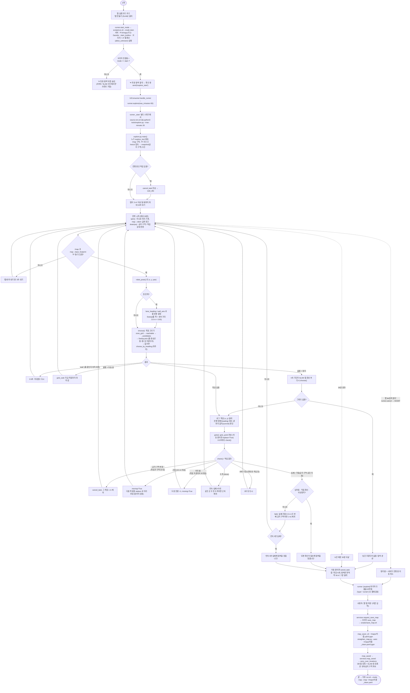
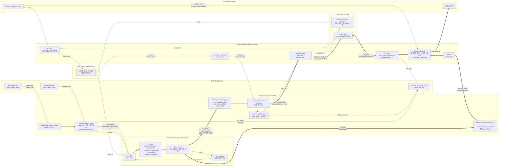
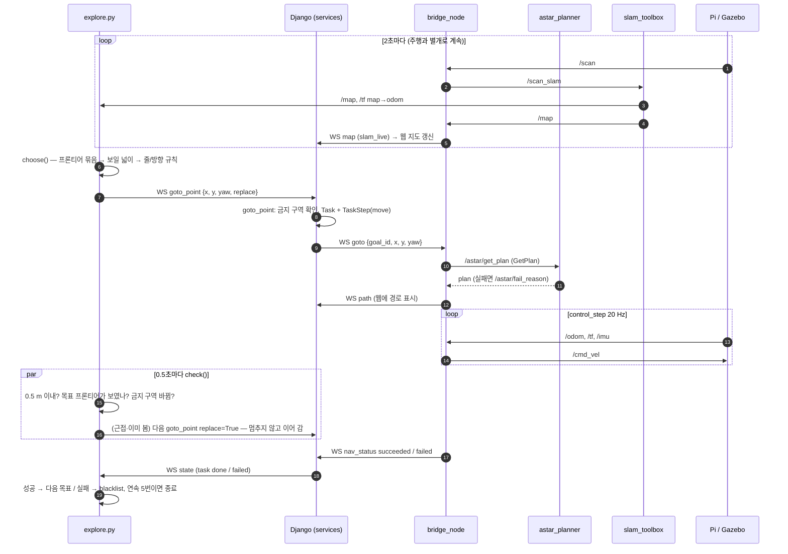

# 자동 맵 만들기 (SLAM 자동 탐색) 진행 과정

웹 "✦ 자동 탐색" 버튼을 누르면 로봇이 미탐색 경계(프론티어)를 찾아 스스로 이동하며 SLAM 맵을 넓히고,
더 넓힐 곳이 없으면 멈춘다. 이후 "맵 저장" 으로 `~/maps/<이름>.yaml` + `_clean.yaml` 을 만든다.

- 탐색기 본체: `tools/explore.py` (ROS 노드 `explore_tool` + 서버 `/ws/ui/` WebSocket 클라이언트, 즉 **웹 화면과 같은 자격으로** 이동 명령을 보냄)
- 실행/중지: `server/warehouse/runner.py` 의 `explore()` / `cancel()` (서버가 별도 스레드에서 프로세스를 띄움)
- 실제 주행: 일반 "여기로 이동" 과 같은 경로 (`services.goto_point` → 브리지 `start_goal` → A* → pure pursuit/DWA → `/cmd_vel`)

> 아래 다이어그램은 Mermaid 입니다. GitHub, VS Code(Markdown Preview Mermaid Support) 등에서 그림으로 보입니다.

---

## 1. 순서도 (수직)

---

## 2. 워크플로우 (수평)

각 상자 = **프로세스(실행 파일 하나) 안의 함수 : 하는 일**, 화살표 글자 = **주고받는 ROS 토픽 / 서비스 / WebSocket 메시지**.
굵은 화살표(`==>`)는 자동 탐색 한 번의 목표 주기(목표 선택 → 이동 → 결과)이다.

### 목표 한 주기 (시간 순서)

---

## 3. 함수별 처리 내용과 발생 토픽 / 메시지

### 3.1 시작·중지 (웹 → 서버 → 탐색기)

| 위치 | 함수 | 처리 내용 | 보내는 것 / 받는 것 |
|---|---|---|---|
| `static/warehouse/app.js` | `#btn-explore` click | SLAM 모드·브리지 연결일 때만 버튼 표시, 확인 창 | WS → `{'action': 'explore_start'}` |
| `consumers.py` | `UIConsumer.handle_runner` | `LIVE[robot]['mode'] == 'slam'` 확인 후 실행 | `runner.explore()` 호출 |
| `runner.py` | `explore(max_minutes=30)` / `_start` | 작업 하나만(락), 스레드에서 `bash -c 'source env.sh && exec python3 -u tools/explore.py --max-minutes 30'` | 끝나면 WS → UI `{'type': 'runner', ...}` (`[explore]` 로그 마지막 2줄) |
| `app.js` / `consumers.py` / `runner.py` | `#btn-explore-stop` → `cancel(EXPLORE_JOB)` | 프로세스 그룹에 SIGINT, 로봇이 MOVING 이면 `services.cancel_task` | 브리지로 WS `cancel` |

### 3.2 탐색기 `tools/explore.py`

| 함수 | 처리 내용 | 구독 / 발행 / 전송 |
|---|---|---|
| `main` (준비) | 노드 `explore_tool` 생성, TF 리스너, 서버 접속, 진행 중 작업 취소, 맵 3 m² 까지 대기 | 구독 `/map` (TRANSIENT_LOCAL), `/tf`·`/tf_static`; WS `/ws/ui/` 접속 → `snapshot` 수신 |
| `spin` | `rclpy.spin_once` 반복, 지나온 자리(`trail`) 0.3 m 간격 기록, map→odom 이 0.5 m 넘게 튀면 경고 | TF `map→base_footprint`, `map→odom` 조회 |
| `handle_msg` / `drain` / `recv` | 서버 메시지에서 금지 구역 갱신(`ZONES['ver'] += 1`), 끝난 작업 기억 | WS 수신 `zones`, `snapshot`, `state` |
| `lane_heading` / `wall_axis` | 벽 점 히스토그램이 가장 뾰족한 각도 = 벽 방향, 로봇 방향에 가장 가까운 것을 줄 방향으로 | — |
| `Sweep.pick` | 줄 단위 왕복(잔디 깎기). 지금 줄 앞쪽 후보 → 줄 중심선 점 우선, 멈춘 뒤 2.5초 동안 앞쪽 후보가 없으면 줄 바꿈 | — |
| `lane_waypoint` | 줄 중심선 근처, 로봇보다 1.0~2.5 m 앞의 안전한 빈 칸 | — |
| `zone_grid` / `reachable` | 금지 구역 칸 + 벽에서 로봇 반경(0.28 m) 떨어진 칸 중 로봇과 이어진 칸 (A* 와 같은 기준) | — |
| `effective_unknown` | 미탐색 칸에서 광선 틈(2칸 이하) 메움, 1 m² 미만 막힌 구멍 제외 | — |
| `frontier_mask` / `frontiers` | 빈 칸 중 4방향에 미탐색이 있는 칸 → 8방향 BFS 로 묶음, 8칸(40 cm) 미만 버림, 40칸(2 m)씩 조각 | — |
| `_candidates` | 묶음마다 중심 1 m 안에서 벽 0.35 m·미탐색 0.2/0.1/0 m 떨어진 칸, `view_gain` ≥ 0.5 m² 인 첫 칸 | — |
| `view_gain` | 후보 칸에서 64개 광선(3.0 m)으로 벽에 막히기 전까지 보이는 미탐색 넓이 | — |
| `choose_by_heading` | 진행 방향 ±60° → ±120° → 전부 순서로 넓히며 `거리 + 0.6×각도 − 0.02×크기` 최소 | — |
| `goto` | 목표 전송 후 작업 끝/`check()` 이유를 기다림, 시간 초과(90초)면 취소 | WS 전송 `goto_point {x, y, yaw, replace}`, `cancel_task`; WS 수신 `state`, `error` |
| `check` (goto 안) | 0.5초마다: 금지 구역 변경 → 목표 도달 불가? / 0.5 m 이내(`근접`) / 목표 프론티어 사라짐(`이미 봄`, `frontier_left`) | — |
| `goto_wait` | 다음 목표가 없을 때 지금 이동이 끝나기만 기다림 | WS 수신 `state` |
| `fail` | 실패 지점 0.5 m(두 번째·금지 구역이면 1 m) blacklist, 연속 실패 5번이면 종료 | — |

### 3.3 서버 `server/warehouse/`

| 함수 | 처리 내용 | 보내는 것 |
|---|---|---|
| `services.goto_point` | 금지 구역 안·같은 지점 반복 실패면 거절(`check_goal_allowed`). `replace` 이고 진행 작업이 '지정 지점' 하나면 그 작업을 끝내고 새 작업으로 (로봇엔 취소 안 보냄 → 안 멈춤) | → `advance` |
| `services.advance` / `send_goal` | 단계 MOVING, 로봇 상태 MOVING, 이동 시간 기록 | 로봇 WS `goto {goal_id, x, y, yaw}`, UI WS `state`, `log` |
| `services.handle_nav_status` | goal_id 일치 확인 → 단일 이동은 성공이면 완료, 실패면 바로 작업 실패 + IDLE (다음 목표를 막지 않음) | UI WS `state` (explore.py 가 이것으로 결과를 앎) |
| `services.handle_map` | SLAM 맵(`slam_live`)을 PNG 로 DB 저장, 활성 맵으로 | UI WS `map`, `zones`; 로봇 WS `zones` |
| `services.request_save_map` / `map_saved` / `carry_over_locations` | 저장 요청 전달 → 저장된 `_clean.yaml` 을 DB 맵으로 등록, SLAM 중 등록한 위치·금지 구역을 (회전 각도 반영해) 복사 | 로봇 WS `save_map`; UI WS `map_saved`, `log` |

### 3.4 브리지 `bridge_node.py` (노드 `warehouse_bridge`)

| 함수 | 처리 내용 | 구독 / 발행 / 전송 |
|---|---|---|
| `on_scan` | 기울지 않았을 때(또는 기운 지 3초 지나면)만 재발행, 웹용 점 전송, 움직이는 장애물 추적 | 구독 `/scan` → 발행 `/scan_level`, `/scan_slam`(`to_slam_scan`: inf 빔 → range_max 바로 아래); WS `scan`, `obstacles` |
| `on_map` / `flush_map` / `send_map` | SLAM 맵이 갱신될 때마다 압축해 전송 (빈 맵은 안 보냄) | 구독 `/map`; WS `map` (name=`slam_live`) |
| `process_inbox` | 서버 메시지 분기 (`goto`, `cancel`, `zones`, `save_map` …) | WS 수신 |
| `on_zones` | 금지 구역이 바뀌면 플래너에 전달, 이동 중이면 0.3초 뒤 재계획 | 발행 `/astar/zones` |
| `start_goal` / `request_plan` | 넘어짐·기울어짐 확인, A* 요청 | 서비스 호출 `/astar/get_plan` |
| `on_plan` | 경로 전송, `PurePursuit` / `DWAFollower` 생성 (hybrid 는 둘 다) | WS `path`; 실패면 `/astar/fail_reason` 을 붙여 `report('failed')` |
| `control_step` (20 Hz) | 금지 구역 재계획, TF 나이·기울기 확인, hybrid 전환, 속도 계산 → `CmdMux` | 구독 `/odom`, `/imu`, TF; (실패·부딪힘 시 발행 `/astar/obstacle`) |
| `mux_step` | 자동 주행·웹 수동 조작·정지 중 우선순위로 골라 내보냄 | 발행 `/cmd_vel` |
| `report` | 결과 전송, 목표 비움, 경로 지움 | WS `nav_status {goal_id, status, message}`, `path []` |
| `save_map` → `run_script` | `scripts/save_map.sh <이름>` 실행 | WS `map_saved {ok, message}` |

### 3.5 그 밖의 노드

| 노드 | 하는 일 | 구독 | 발행 / 제공 |
|---|---|---|---|
| `slam_toolbox` (`config/slam_toolbox.yaml`, mode=mapping) | 스캔 매칭 + 루프 클로저로 맵 작성, 0.05 m 격자, 2초마다 맵 갱신, max_laser_range 5.0 m (sim 3.4 m) | `/scan_slam`, `/tf` (odom→base_footprint) | `/map`, `/tf` (map→odom) |
| `astar_planner` (`allow_unknown=true`) | 미탐색 칸도 통과하는 A*, 금지 구역 반영, 실패 이유 발행 | `/map`, `/astar/zones`, `/scan_level`, `/astar/obstacle` | 서비스 `/astar/get_plan`, `/astar/fail_reason`, `/astar/plan` |
| Pi bringup / Gazebo | 센서·모터 | `/cmd_vel` | `/scan`, `/odom`, `/imu`, `/tf` (odom→base_footprint), `/battery_state` |

---

## 4. 종료 조건 정리

| 조건 | explore.py 로그 | 비고 |
|---|---|---|
| 프론티어 없음 (4초 더 기다려도) | `남은 프론티어 없음: 탐색 완료` | 정상 완료 |
| 시간 제한 | `시간 제한 30분 도달` | 웹 실행은 30분 고정, 명령줄 기본은 20분 |
| 연속 실패 5번 | `연속 5번 실패해 탐색을 멈춥니다` | 실패 지점은 매번 blacklist |
| 넘어짐 / 직접 확인 / 비상정지 | `로봇 확인이 필요해 탐색을 멈춥니다` | 상태 초기화 후 다시 시작 |
| 웹 "■ 탐색 중지" | `중지됨` (종료 코드 130) | 서버가 진행 중 이동도 취소 |

모든 경우 마지막에 `끝: 목표 N개 (도착 a, 이어 가기 b, 도중 전환 c), 탐색한 면적 약 M m², T분` 이 출력되고(중지 제외),
runner 가 마지막 두 줄을 웹 알림으로 보낸다. 맵은 자동 저장되지 않으므로 **웹 "맵 저장" 을 눌러야** `~/maps/` 에 남는다.
