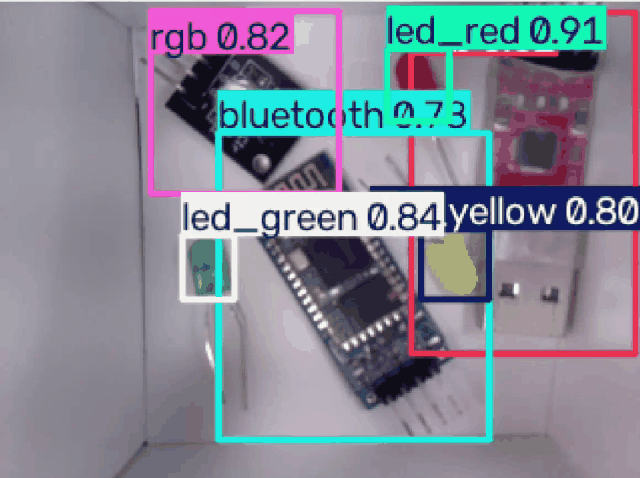
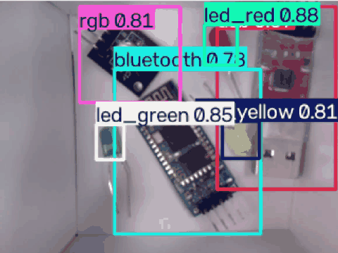
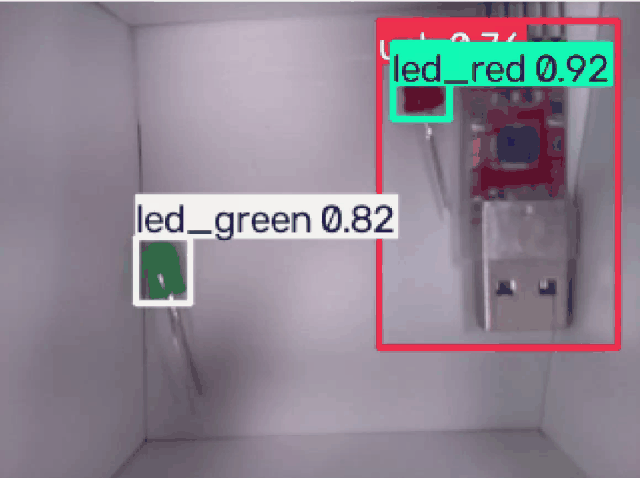

# team_project2

TurtleBot3 카메라 영상을 노트북에서 YOLO로 검출하고, 클래스별 개수와 검출 영상을 ROS 2 토픽으로 제공하는 프로젝트입니다.

환경: Ubuntu 22.04 · ROS 2 Humble · Python 3.10 · ROS_DOMAIN_ID=44

## 문제 상황 → 조치

| 문제 상황 | 조치 |
|---|---|
| 저해상도 실시간 영상에서 신뢰도 저하 | YOLO11n에 해상도 저하·흐림·압축·노이즈 증강을 적용해 추가 학습. LED 색상은 유지 |
| RGB 클래스의 검출 불안정 | 학습 모델은 보관하고, 실시간 검출·개수 결과에서 `rgb`만 제외 |
| 빈 박스에서도 불필요한 추론 지속 | 별도 ON/OFF 버전에서 `enabled` 파라미터로 추론·영상·개수 발행 중지/재개 |
| 영상 창 없이 개수만 필요 | `/yolo/counts`를 문자열로 초당 약 1회 직접 발행 |
| rqt 없이 검출 장면을 확인하고 싶음 | `capture_once=true`로 다음 검출 결과를 PNG 한 장으로 저장 |
| 여러 컴퓨터에서 원본 영상을 보면 FPS 저하 | 중복 원본 구독을 줄여 비교. 뷰어 2개일 때 노트북 8.5 FPS → 뷰어 없이 측정 구독만 사용 시 22.8 FPS |

압축 전송·카메라 FPS 제한은 추가 개선안이며 기본 실행에 자동 적용하지 않았습니다. 위 측정은 당시 환경의 비교 결과로, 고정 성능을 의미하지 않습니다.

현재 검출 대상: `DHT11`, `bluetooth`, `led_green`, `led_red`, `led_yellow`, `usb`.
학습 데이터·가중치는 RGB를 포함한 7클래스이며, 실행 시 RGB를 필터링합니다. 다중 물체·가림 상황의 추가 데이터 보강은 남은 과제입니다.

## 설치

노트북에 ROS 2 Humble이 설치된 상태에서 저장소 루트에서 실행합니다.

```bash
sudo apt install python3-venv ros-humble-rqt-image-view
python3 -m venv --system-site-packages yolo_training/.venv
yolo_training/.venv/bin/python -m pip install torch torchvision --index-url https://download.pytorch.org/whl/cpu
yolo_training/.venv/bin/python -m pip install -r requirements.txt
```

## 실행

라즈베리파이: 카메라의 실제 캡처 장치를 확인한 뒤 실행합니다.

```bash
sudo apt install v4l-utils ros-humble-v4l2-camera
v4l2-ctl --list-devices
bash camera.sh /dev/video0
```

`camera.sh`는 640×480, `/csi/image_raw`로 발행합니다. 장치 번호는 재부팅·USB 연결에 따라 달라집니다. CSI MMAL 장치와 USB 웹캠의 메타데이터 장치를 구분하세요.

노트북: 카메라와 같은 네트워크에서 ON/OFF 버전을 실행합니다. 영상 창은 열리지 않습니다.

```bash
python3 python_project/yolo_switch.py --ros-args -p imgsz:=640
```

출력: `/yolo/image_raw`(검출 영상), `/yolo/counts`(`std_msgs/msg/String`, 현재 프레임의 클래스별 개수). `imgsz:=320`은 속도 우선, `640`은 작은 물체 검출 우선입니다.

다른 노트북 터미널에서:

```bash
source /opt/ros/humble/setup.bash
export ROS_DOMAIN_ID=44

# 추론·결과 발행 중지 / 재개
ros2 param set /component_detector_switch enabled false
ros2 param set /component_detector_switch enabled true

# 검출 장면 한 장 캡처: rqt 불필요
ros2 param set /component_detector_switch capture_once true

# 현재 개수 확인
ros2 topic echo /yolo/counts
```

캡처는 `~/camera_dataset/captures/yolo_날짜_시간.png`에 박스·이름·신뢰도와 함께 저장됩니다. 요청을 처리하면 `capture_once`는 자동으로 `false`가 됩니다. 영상이 없거나 `enabled=false`이면 다음 검출까지 대기하며, `capture_once=false`로 요청을 취소할 수 있습니다. 중지 시에는 이전 프레임을 비우고 재개 후 새 프레임부터 처리합니다. 터틀봇의 카메라 발행은 별도로 유지됩니다.

기존 실행 파일도 유지합니다. 동일 출력 토픽을 사용하므로 검출기는 하나만 실행하세요.

```bash
python3 python_project/yolo_ros.py       # 기존 영상 발행 버전
python3 python_project/yolo_preview.py   # 기존 검출 + rqt 영상 창
```

사람만 검출하려면 사전 학습 모델을 선택합니다. 최초 실행에는 다운로드가 필요합니다.

```bash
python3 python_project/yolo_switch.py --ros-args \
  -p weights:=yolo26n.pt -p person_only:=true -p imgsz:=320
```

`person_only`는 COCO 사람(ID 0) 필터입니다. 부품 모델에는 사용하지 마세요.

## 데이터 수집 / 학습

```bash
source /opt/ros/humble/setup.bash
export ROS_DOMAIN_ID=44
/usr/bin/python3 python_project/test.py --count 100
/usr/bin/python3 yolo_training/zoom_camera.py --ros-args -p zoom:=1.5
# 줌 노드를 켜둔 상태에서 별도 터미널로 실행
/usr/bin/python3 python_project/zoom_test.py --count 100
```

일반 캡처는 `~/camera_dataset/images`, 줌 캡처는 `~/camera_dataset/zoom_images`에 저장됩니다. 줌 영상은 `/camera/zoom`이며 디지털 확대는 세부 정보를 복원하지 않습니다.

- 처음 학습: Colab GPU 런타임에서 `colab/train_components7_yolo11.ipynb` 실행 → 업로드 셀에서 `components_dataset.zip` 선택
- 추가 학습: `colab/finetune_components7_lowres.ipynb` 실행 → 업로드 셀에서 `components7_finetune_bundle.zip` 선택
- 결과 `best.pt`를 `yolo_training/best_components7_finetuned.pt`로 교체해 적용

학습 243장 / 검증 63장. 추가 학습 모델의 검증 mAP@50 99.5%, mAP@50–95 74.3%. 같은 촬영 환경의 소규모 검증으로 실시간 정확도를 보장하지 않습니다. `electric bulb`는 제외했고 단색 LED 라벨은 금속 핀을 제외합니다.

## 실행 영상

### 영상 1

[](videos/demo_01.webm)

[원본 영상 보기 · 09:48:57](videos/demo_01.webm)

### 영상 2

[](videos/demo_02.webm)

[원본 영상 보기 · 09:49:22](videos/demo_02.webm)

### 영상 3

[](videos/demo_03.webm)

[원본 영상 보기 · 09:54:15](videos/demo_03.webm)

README에서는 크기와 프레임 수를 줄인 GIF가 자동 재생됩니다. 원본 WebM은 위 링크에서 확인할 수 있습니다.
